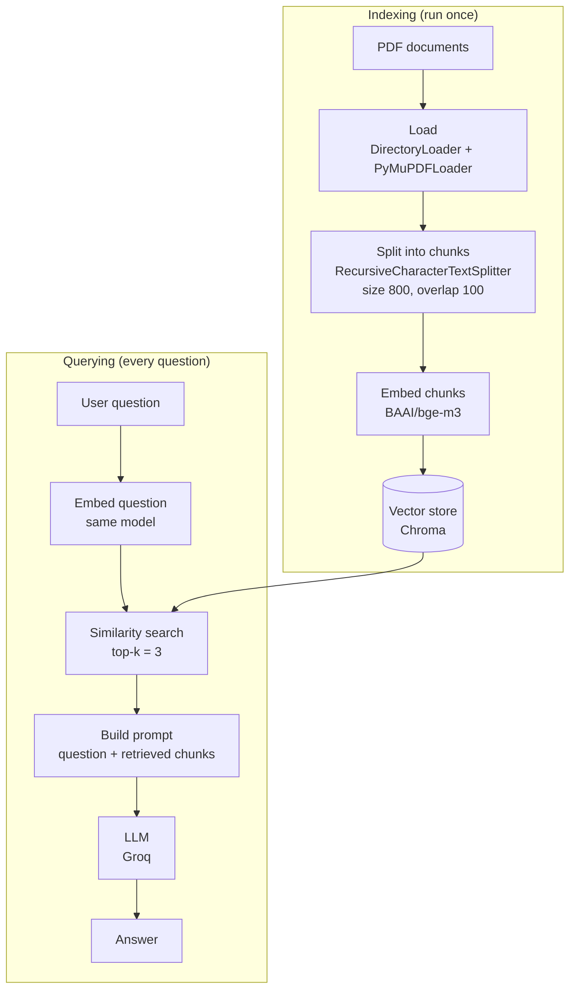

# Naive RAG

A simple RAG (Retrieval-Augmented Generation) pipeline. It loads PDF documents, splits them into chunks, stores the embeddings in a vector database, and answers your questions using the chunks it retrieves.

---

## How Naive RAG Works

---

## Why do we need RAG?

Large language models (LLMs) are pre-trained on massive text data like the internet, code, social media and books. This lets them generate text, answer questions, translate languages and more, without any task-specific data. But their knowledge is still limited.

- LLMs are **not trained on your private data**. If you ask them about private info, they either don't know the answer or they pretend like they know. This is called **hallucination**.
- RAG fixes this. It finds the relevant pieces of your data and gives them to the LLM along with the question, so the LLM answers from your data instead of guessing.
- RAG is great when you want to build:
  - a **customer chatbot**
  - a **company HR chatbot** that helps employees get answers about company policies, like a contract policy or any other policy

---

## Steps to Create a Naive RAG

1. **Document loader** - load a document like PDF, CSV, web pages, text file, or load data from a database.
2. **Chunks** - split the data into small chunks.
3. **Embeddings** - convert the chunks into embeddings using an embedding model like OpenAI embeddings or HuggingFace embeddings.
4. **Vector DB** - add the embeddings in a vector database so you can retrieve them when you want.
5. **User query** - convert the user query into an embedding. Then the vector DB checks the similarity score with the other chunks and retrieves the top-k chunks.
6. **Create chain** - create an AI prompt and pass the retrieved chunks and the question in that prompt.
7. **Answer** - the LLM reads the prompt and gives the final answer.

---

## Tech Used

| Part | What I used |
|---|---|
| Framework | LangChain |
| Loader | `DirectoryLoader` + `PyMuPDFLoader` |
| Chunking | `RecursiveCharacterTextSplitter` (size 800, overlap 100) |
| Embeddings | `BAAI/bge-m3` (HuggingFace) |
| Vector DB | Chroma |
| LLM | Groq (`openai/gpt-oss-120b`) |
